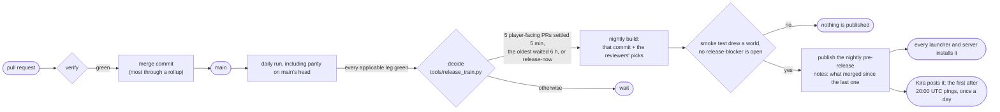

# Release flow

How a change gets from a pull request to players: the checks a pull request passes, how it merges, and the
automatic releases that follow. Releases are automatic and frequent so the latest Sunrise is always playable.
Since 2026-10-28 Sunrise ships the **Nightly** instead of `vX.Y.Z` releases (Ludovic's decision; the Team proposed
it): the batch train builds a Nightly, it is published once its smoke test passed and no `release-blocker` is open,
and launchers and Nightly servers update to it ([The Nightly and stable releases](#the-nightly-and-stable-releases)). Stable releases (`26.3-<semver>`) are
published from the approved head of `release/26.3`, which is cut from a green daily's commit and takes later fixes by
pull request, and a server installed on one updates within its line ([Release branches](#release-branches)).

## Pull request checks

Rollups, syncs and main's pushes are checked by one gate, `dyna-checks` (`.github/workflows/dyna-ci.yml`: `lint`,
`verify`, `verify-static`); a plain pull request gets its cheap checks there (`format`, `verify-static`)
([CONTRIBUTING.md](../CONTRIBUTING.md#ci-tiers)), forks' included. The `checks` workflow (`.github/workflows/ci.yml`)
runs a full `verify` of main on GitHub's runners every 6 hours, on any ref by hand
(`gh workflow run checks --ref <ref> -f verify=true`), and on a pull request, a fork's included, when a maintainer adds
the label `ci:verify`. Pushes never start it: until 2026-11-18 every push to a fork's pull request ran it, which held
the organisation's GitHub-hosted runners ahead of the release jobs. The label stays after the run (a fork's run has a
read-only token, and no fork code ever gets a writing one); remove it and add it again to run `verify` on a newer
head. A dispatch without `verify` runs only its by-hand jobs (Windows ARM64 and JFR analysis):

| Job | Runs on | What | Time |
| --- | --- | --- | --- |
| `verify` | Scheduled runs on main, dispatches with `verify` and pull requests labelled `ci:verify`, on GitHub's `ubuntu-24.04` | Three jobs side by side: the public-tree check and Python tests (`verify (tree and tools)`), rustfmt and clippy with warnings denied (`verify (format and lint)`), the Rust tests of the whole workspace (`verify (Rust tests)`); `verify` waits for them and passes when each passed. Dependencies and the workspace build come from a cache saved by scheduled runs on main | ~8 min |

A maintainer-requested check on a fork may skip individual parts only when a complete diff of the pull request's
base and head rules them out. Scheduled runs and manual verification run every part. `verify` still reports the
combined result even if the run is cancelled. Its public-tree check reads every ref's history.

## Merging

Pull requests merge with a merge commit (`Merge pull request #123 from ...`), most of them through a rollup: a
`sunrise-review-rollup-<n>` branch that carries reviewed pull requests at their heads, with integration fixes as carry
commits on top, and is checked by `dyna-checks` like any rollup. A pull request's own commits stay as they are, and it
shows as merged when its rollup merges. No workflow has a `merge_group` trigger: there is no merge queue. Never
`gh pr merge --auto`. Branch protection on main
requires `verify` for everyone, and a council member's review (team `council`) for the files `.github/CODEOWNERS` lists (what builds, signs
and ships releases). Branches don't have to be up to date with main: main's own `dyna-checks` run catches the rare
semantic conflict.

**Who merges.** The Sunrise Team (GitHub team `sunrise-team`: kacpherek, levzzz5154, rdbtCVS, Online5277, dezer-x) and
Ludovic. The orchestrator's agents prove only the risky pull requests (below), so a contributor's ordinary pull
request doesn't wait for them.

**An ordinary pull request merges on CI.** A Team member:

1. reads the whole diff;
2. merges once `verify` passes, nobody's change request is open, and every comment has been read (a
   "don't merge" from anyone holds it).

Never merge your own pull request: another Team member reviews and merges it. Never push to, force-push or rebase a
contributor's branch. On this fork small fixes go in our own commits on top of theirs in a rollup, their commits stay
intact, and their pull request shows as merged.

**A risky pull request gets the `needs-proof` label** and waits for an agent's local proof (both single-player
paths, `lan_e2e`, a screenshot for anything visible) before it merges. Risky means any of:

- it changes what is saved or loaded (`save.rs`, `entity_nbt.rs`, `block_entity_nbt.rs`, `region.rs`, `datafix/`):
  a bug there damages players' worlds;
- the network or the server thread: `sunrise-protocol`, `net.rs`, `remote*.rs`, `lan/`, `lan*.rs`,
  `integrated.rs`, `levels.rs`, `dedicated*`;
- world generation (`worldgen/`): seeds must keep generating the same terrain;
- the launcher's installs and updates, or the mod runtime;
- the harnesses themselves (`tools/test_*_parity.py`, the Java oracles): a wrong harness hides regressions;
- over ~3000 lines of code ([what counts](../CONTRIBUTING.md#pull-requests)).

Unsure? Add `needs-proof`: it costs a few hours, a broken release costs more.

## Parity on main

The [daily run](#daily-run) is the only CI entry point for vanilla parity. It calls `.github/workflows/parity.yml`
on every real (writing) run, which takes only commits of main, so no run can move `daily-green` or start the
Nightly without it. Dry runs, rollups and pull requests do not run parity. The Dyna runners use their prepared
vanilla data and run all automatic harnesses in shares of one plan (`tools/ci/parity_shards.py`,
`tools/parity.py --harness-file`). They replay an earlier vanilla oracle run from the CI host's keep only when its
command, JDK and inputs match ([parity workflow](parity-workflow.md)); the daily summary reads the shares' merged verdict.
`named_only` in `tools/parity_hosts.json` lists the exceptions, such as `frame_identity`, each with its reason; run them
locally by name. Proofs that need arguments (a saved capture to replay) declare `PARITY_MANUAL` in their script instead,
which no automatic run selects.

The daily summary files one `bug` issue per failing harness with the merges since the previous green daily as
suspects. A failed or incomplete required parity leg holds `daily-green` and the automatic Nightly, but not the
SDK. Only names and outcomes are public; raw harness output and retry details stay on the runner.

## Game releases

`.github/workflows/release.yml` is the batch train: it decides when a new Nightly goes out and starts
`nightly build` (`.github/workflows/nightly-build.yml`, [Nightly channel](#nightly-channel)) on the commit it
decided, which builds, signs and publishes it. On the fork it runs only when the [daily run](#daily-run) calls it
with a fully green commit, or by hand (`kind`: `nightly` or `dev`); it has no schedule and no `workflow_run`
trigger since 2026-11-13.

| | [Dev](#dev) | [Nightly](#nightly-channel) | [Stable](#release-branches) |
|---|---|---|---|
| Started by | Root: `release.yml -f kind=dev -f dry_run=false` on `main` | The [daily run](#daily-run), or a dispatch | Root: `nightly-build.yml -f kind=stable` on `release/26.3` |
| Built from | A commit on `main` with Dev version support and the gate (`lint`, `verify`, `verify-static`) green | The head of `nightly/26.3`, which the daily fast-forwards to each fully green commit; `daily-green` while that branch doesn't exist | The approved head of `release/26.3`, with a fully green daily run on that commit |
| SDK | `release.yml` publishes `sdk-<sha>` first | The daily publishes `sdk-<sha>` first | A daily on the approved commit publishes `sdk-<sha>` first |
| Tag / title | `dev-<date>-<short>` / `Dev <date> · <short>` | Rolling `nightly` / `Nightly <date> · <short>` | `26.3-<semver>` / `Sunrise 26.3-<semver>` |
| Signed for (`.sig` / `.v2.sig`) | `dev` / `dev-<date>-<short>` | `nightly` / `nightly-<date>-<short>` | The release tag for both |
| GitHub release kind | Pre-release, not latest | Pre-release, not latest | Full release, `--latest=false` |
| Retention | Seven days; the newest is always kept (`nightly.py prune-dev`) | Current `nightly` stays; dated copies are kept for seven days, with at most one per date | Kept permanently |
| Launcher | From 1.1.3, install by exact tag (`sunrise-launcher install <tag>`); until then, download and verify by hand | Nightly profiles follow `nightly` | Stable profiles read full releases with stable tags |
| `sunrise-server` | Refuses Dev builds | Uses `nightly` by default | Can install by explicit stable tag |

### Dev

A Dev build is how a change to packages or platform legs is tested after it merges: none of those jobs runs on a pull
request. Root dispatches `release.yml` with `kind=dev` on main, for main's head or `-f commit=<sha>` of a
commit on main. In order:

1. `decide` (`tools/release_train.py decide --channel dev`) refuses a commit that is not on main, or whose
   newest dyna-checks main-push run did not pass every gate job (a pending job is not passed). It also refuses
   commits whose source predates the Dev version label. It does not wait for daily tests, `daily-green`,
   batch rules, a daily cap, a pause or a release-blocker.
2. `dev-sdk` builds the commit's prebuilt SDK on every OS (`prebuilt-game-build.yml`; skipped when
   `sdk-<sha>` already exists). A build it makes runs the SDK's own checks too, as the daily run's does: the native
   linkage probe on the Linux and Windows client legs, and the API-source check and the source stage
   (`tools/ci/test_stage_catalog.py`) on Linux; an `sdk-<sha>` that already exists is reused as it is, and no check
   runs again. `dev-sdk-publish` signs and publishes it as `sdk-<sha>` from this run's
   artifacts through `sdk-publish.yml`, the one workflow that publishes an SDK (the daily run and `prebuilt-game.yml` call it too).
3. `dev` starts `nightly build` with `kind=dev` and that commit. It re-checks the gate and the SDK, builds
   the commit alone (no picked pull requests, no build branch, no nightly-state), as `SUNRISE_VERSION`
   `dev-<date>` so the game calls itself "Dev <date> · <short>", signs it for the `dev` channel and
   for `dev-<date>-<short>` (`SHA256SUMS.sig`, `SHA256SUMS.v2.sig`, the Nightly's key), checks the smoke test
   and publishes the pre-release `dev-<date>-<short>` titled "Dev <date> · <short>". A commit already published
   that day is skipped. Dev builds older than 7 days are deleted, never the newest one,
   and never an `sdk-<sha>` SDK. The Dev build carries its SDK's `sdk.json` in its signed sums, as the Nightly does,
   so the launcher reads its build id from it and builds native mods against `sdk-<sha>`.

It never touches the `nightly` tag or channel, its rotation, its `nightly-source/` tags or `daily-green`. A dry run
(the default for a dispatch, and any run off main) builds, indexes and signs the SDK with a throwaway key
(`sdk-publish.yml` with `publish: false`, run only when `sdk-<sha>` does not exist yet), builds the game (a
`nightly build` dry run, signed with a throwaway key) and publishes nothing; its summary names what a real run would
publish. Starting with Sunrise Launcher 1.1.3, install Dev builds by exact tag (`sunrise-launcher install <tag>`);
until then, download the assets from GitHub and verify the files for the exact tag:

```sh
sunrise-release-sign verify --tag dev-<date>-<short> --signature SHA256SUMS.v2.sig <folder>
```

### Daily run

`.github/workflows/daily.yml` runs the in-game legs once a day, at 09:00 UTC on main's head, and when root
dispatches it (`-f commit=<sha>`, `-f dry_run=false` to write). One run runs and at most one waits; a newer waiting
dispatch replaces an older waiting one. The schedule stops when main's head already has a completed real daily run;
a hand dispatch never does, so it retries a run whose tag move, issues or nightly failed. Its legs are the workflows that left main pushes:
the ignored-tests data shards (`ignored-tests.yml`),
`fn-replace-check.yml`, the game's Windows runtime-lease tests (`windows-runtime-leases.yml`), every
`cargo-sunrise-mod` binstall archive built from the commit and published nowhere (`cargo-sunrise-mod-build.yml`; a pull
request's check builds only the Linux x86_64 archive, and only a `cargo-sunrise-mod-v*` tag's push publishes, from
`cargo-sunrise-mod.yml`), the machine sample built against the commit's mod API (`machine-sample.yml`), the modding book's start pages
(`book-quickstart.yml`, below) and the
prebuilt SDK of the commit
(`prebuilt-game-build.yml`; each leg packs its slices after the checks, including the [native linkage probe](native-dylib-probe.md)
on the Linux and Windows client builds. `sdk-publish` signs and publishes the slices as the mod SDK's
release `sdk-<sha>` (`sdk-publish.yml`) only when its own legs are green on a real run on main, before the Nightly that
needs them; a failed publish files one issue, `Daily: sdk-publish did not complete`), each called
with the commit. The [vanilla parity leg](#parity-on-main) runs after the shards when applicable. Its
summary (`tools/ci/daily_summary.py`) reads each leg's result and its sanitised verdict file, never a log:

- every applicable leg green: the tag `daily-green` moves to the commit, and `release.yml` (kind `nightly`) publishes the
  Nightly of that commit whenever a player-facing pull request merged since the published one (no batch-size or
  age rule; the pause switch and release-blockers still hold it);
- a failing test: one issue `Daily: <crate> <test>` (label `bug`) with its panic location, the first daily run that
  saw it and the pull requests merged since the last green daily as suspects; later runs comment on it, and the
  first run where it passes closes it. A leg that failed without a test name gets one issue per leg. A red machine
  sample is no break: its one issue, `Daily: update the machine sample for the mod API change`, asks for the sample
  to follow the API change and its pin to move.

The book's quickstart leg runs `tools/book_quickstart.py`: every `sh` block of `docs/modding/src/start/`, in a fresh home on a
runner with no launcher on its PATH, since the mod tools never need one. The install page's download runs against the real published
release, as a reader's does. The mod pages then run with `cargo-sunrise-mod` built from the commit as a debug-assertions build and
against this run's own SDK, not the previous Nightly's, so a red quickstart cannot block the Nightly that would clear it. The SDK
folder is laid out by `tools/ci/assemble_sdk_folder.sh`, which `fn-replace-check.yml` uses too (its `sdk-<sha>` folder, signed with a
throwaway key that only a debug-assertions build trusts through `SUNRISE_SDK_TRUSTED_KEY`; `prebuilt_game.py tool`,
which builds the tool every SDK and mod-tool release ships, refuses a build that reads that variable), plus `nightly/sdk.json` so a `new`
with no `--sunrise` resolves to it through `SUNRISE_SDK_BASE`. It is an ordinary leg, outside `sdk_green`. A hand dispatch of
`book-quickstart.yml` checks the published release instead.

The SDK publishes on its own legs (`sdk`, `machine-sample`, `fn-replace-check`: the summary's `sdk_green`) until a runner with prepared data exists (umceko, 2026-11-16). A red linkage probe fails its `sdk / build linux` or `sdk / build windows` job and blocks publication.

Only a run on `main` with `dry_run` false moves the tag, files issues or publishes; a real run on `release/26.3`
publishes only its SDK ([Release branches](#release-branches)); any other run prints what it would do. On Sunrise a Nightly ships a commit of main with its dyna-checks gate green and its SDK, `sdk-<sha>`, published
first on the same commit: a game build without its SDK is never published (owner, 2026-11-17).
A [Dev build](#dev) (`release.yml -f kind=dev`) needs only dyna-checks' gate on its commit of main.



### When it releases

`tools/release_train.py decide --kind game` looks at the pull requests merged into main (first-parent merge
commits) since the commit the published Nightly was built on:

- A pull request counts when it changed what players run: `crates/` (not `examples/`, `tests/`, `benches/`),
  `xtask/`, `packaging/`, `Cargo.toml`, `Cargo.lock`, `research-lock.json`, or an exporter `sunrise-prepare`
  compiles (the `mods/sunrise/src/test/java/dev/sunriselab/parity/*.java` files its sources name). Markdown never
  counts.
- It goes in batches, so players get a few Nightlies a day rather than one per merge: once 5 pull requests count
  and the newest of them merged at least 5 minutes ago (a wave of merges becomes one Nightly), or once the oldest has
  waited 6 hours, however few they are.
- A pull request labelled `release-now` (a crash or a blocker) goes out at once.
- A pull request labelled `skip-release` (work players don't see) doesn't count and isn't listed in the notes.
- An open issue labelled `release-blocker` holds every Nightly, forced ones too (`held by release-blocker #N`);
  `nightly build` checks again right before publishing.
- One Nightly build at a time: while one runs or waits, the train starts none. At most 12 builds a UTC day (the
  reviewers' `/nightly` builds count): past that the train waits for the next day, except for `release-now` and
  `force=true`.
- The daily calls the release train only from its green summary. A by-hand Sunrise dispatch selects main's head or
  an explicit base on main with its dyna-checks main-push gate green.

### The Nightly and stable releases

Ludovic decided on 2026-10-28 that Sunrise ships the Nightly instead of `vX.Y.Z` game releases; stable releases
(`26.3-<semver>`, [Release branches](#release-branches)) have joined it since. No `vX.Y.Z` game release is made any
more: the last one stays GitHub's *latest*, so launchers and servers from before the switch (which don't read
Nightlies) keep a working build until they update themselves. `.github/release-line.txt` still numbers the launcher's releases
(`launcher@X.Y.Z`).

- **Launchers** (#3342) install the current `nightly` pre-release as their update, as the version
  `nightly-<date>-<commit>`, after checking its checksums signed for the Nightly channel. A player on the newest
  release, on a Nightly or on nothing moves to it at the next check; a version picked by hand or pinned by an
  instance stays. Worlds are in the game's folder, never in a version's, so nothing touches them. The "Nightly
  builds" setting is gone. The last week's Nightlies (`nightly-<date>`) and the old releases stay on the Versions
  page.
- **Servers**: `install.sh` and `install.ps1` install the current Nightly unless given a release's tag, and
  `sunrise-server update` then keeps a Nightly server on the Nightly. A server installed on a stable release
  (`install.sh --version 26.3-0.1.0`, or `install.ps1 -Version 26.3-0.1.0` on Windows) is updated within that
  release's line instead ([server.md](server.md), section 7).
- **Kira** posts each Nightly in #releases; the bug template asks for the version the game shows.
- **Everyone gets the reviewers' picks.** A Nightly is main plus the pull requests the trusted reviewers picked
  ([below](#trusted-reviewers-pick-the-nightlys-pull-requests)), so a pick reaches every player with the next
  Nightly. `/nightly clear` makes it main alone.

### Labels

| Label | Effect |
| --- | --- |
| `feature` | Listed under **New** in the Nightly's and the launcher's notes |
| `release-now` | A Nightly past the batch rule and the day’s cap |
| `skip-release` | Doesn't trigger a Nightly or a launcher release and isn't listed in the notes |
| `bug` | Opened by the daily summary for a failing harness on main |
| `release-blocker` | On an issue: no Nightly is published while it is open ([When it releases](#when-it-releases)) |

Pull requests without `feature` are listed under **Fixed**. Titles are written for players, since they become
the notes.

### Builds

| Archive | Runs on | Checks |
| --- | --- | --- |
| `sunrise-linux-x86_64.tar.gz` | Blacksmith `ubuntu-2204` (GitHub's `ubuntu-22.04` with `BLACKSMITH=off`; an older glibc, so it runs on any recent distribution) | the standard loader and libraries only (`tools/check_imports.py`) |
| `sunrise-linux-musl-x86_64.tar.gz` | Same Ubuntu runner type as Linux; glibc-hosted Rust cross-compiles to `x86_64-unknown-linux-musl` | musl loader and libraries only, no RPATH/RUNPATH or glibc version requirements (`tools/check_imports.py --musl`), CPU baseline and startup of every packaged program in plain Alpine |
| `sunrise-server-linux-x86_64.tar.gz` | the same Linux job, after the client archive: `sunrise-server`, `sunrise-prepare` and the game built with `--no-default-features` as `sunrise-engine` (docs/server.md) | as above, and neither `libasound.so.2` nor `libudev.so.1` (`tools/check_imports.py --server`) |
| `sunrise-windows-x64.zip` | Blacksmith `windows-2025` (GitHub's `windows-latest` with `BLACKSMITH=off`), C runtime linked in | system DLLs only (`tools/check_imports.py`); PE machine is x64 |
| `sunrise-windows-arm64.zip` | Blacksmith `windows-2025`, cross-built for `aarch64-pc-windows-msvc` (natively on GitHub's `windows-11-vs2026-arm` with `BLACKSMITH=off`), C runtime linked in | system DLLs only (`tools/check_imports.py`); PE machine is ARM64; every program's startup checks from the packaged archive on GitHub's native `windows-11-vs2026-arm` |
| `sunrise-macos-arm64.zip` | Blacksmith's M4 `macos-15` (GitHub's `macos-15` with `BLACKSMITH=off`) | system libraries only (`otool -L`) and every program's startup checks |
| `sunrise-macos-x64.zip` | The same machine type, cross-built for `x86_64-apple-darwin` (#1161) | system libraries only (`otool -L`); startup checks of every program from the packaged archive on native Intel (GitHub's `macos-15-intel`, #1602), which the archive must pass to ship |

Each builds `sunrise-client`, `sunrise-ctl`, `sunrise-prepare`, `sunrise-server` and `sunrise-port-pack` in release mode, checks they
exist, verifies Windows PE architectures, checks the `--help` and `--version` entry points, packages the folder with
`cargo run -p xtask -- package` and archives it. The
legs are fresh machines. The game's run of a new world (1500 offscreen frames, `smoke-test.json`, which the Nightly
publishes) is `linux-smoke`'s, on Dyna's runner with the prepared files, from the hosted Linux archive.

On Windows, the binaries built by `sunrise-game` and `sunrise-official`, and the SDK's `sunrise_native_game`,
reserve 8 MiB for the main thread (`/STACK:8388608` with MSVC, `-Wl,--stack,8388608` with GNU). This gives
startup's by-value `Game` construction more room than the Windows default. The by-hand Windows ARM64 job in
`checks` (`gh workflow run checks --ref <ref>`) checks `SizeOfStackReserve` in both Cargo game executables built
from that same ref. The packaging workflow checks the PE architecture, not the stack size, because snapshots can
package older revisions with a different reservation. Other shipped executables and platforms use their default
main stack. The SDK sets the flag when it links the executable; `sunrise-prebuilt.json` does not carry `link_args`.
Gameplay workers request their own 8 MiB stack; the integrated server honors a larger `RUST_MIN_STACK`. The Linux
smoke run starts it without that override.

The musl archive is an optional manual download for musl-based Linux desktops; see
[installation and updates](native-client.md#musl-linux-manual-installation). The launcher still selects the
standard glibc archive. Nightlies and Dev builds publish without waiting for the musl build. The release notes
say that the archive follows separately. After publication, `musl-attach` signs and verifies `SHA256SUMS-musl`
with `SHA256SUMS-musl.sig` for the channel and `SHA256SUMS-musl.v2.sig` for its exact build. It adds those files
and then the archive without replacing the launcher's `SHA256SUMS` or its signatures. It writes to the release
`publish` made, addressed by its id, and only while its tag still names the build's commit. GitHub uploads each file
on its own, so a failed upload can leave the first files attached: a rerun keeps a file already there with the same
bytes and stops at one with other bytes, or one GitHub holds unfinished, replacing nothing; only an empty
placeholder of an upload that never began is removed. Build, signing or upload
failures file a `bug` issue without editing the published release or replacing assets. Dry runs build, sign with a
throwaway key and verify without publishing assets or filing issues.

[`game-build.yml`](../.github/workflows/game-build.yml) supplies the GCC toolchain and sysroot from a digest-pinned
Alpine 3.22 image. The musl client and tools keep audio and controllers enabled and link musl dynamically
(`-C target-feature=-crt-static`) to load graphics and window libraries at runtime. The Ubuntu packer bundles the
artifacts, then startup checks run in the same Alpine base with only the runtime libraries added. The dedicated
server archive remains glibc; the bundled musl `sunrise-server` refuses automatic updates to glibc archives.

Musl gameplay parity is not yet validated. On x86-64, `sunrise-core::jmath` uses the platform libm for several
functions, so musl may round differently from glibc or HotSpot. Values near a simulation threshold could
therefore change world generation or mob behaviour for the same seed. This build has no musl parity results;
CLI startup checks do not establish gameplay parity. Before merging the platform support, record a successful
Nightly dry run and a musl-desktop launch covering the title screen, a new world, sound and a controller.

Building Windows ARM64 locally: [Windows ARM64](windows-arm64.md).

### Notes

`tools/ci/nightly.py pick` writes them: what reached main since the previous Nightly (`### New`, label `feature`,
and `### Fixed`, one line per pull request: its title, its number, the issues it closes; `release_train.bullet`),
then the picked pull requests (`### Not merged yet`), `### Known issues` (the bullets of
[docs/known-issues.md](known-issues.md)), thanks to outside contributors, the source commit and the disclaimer. The
title stays `Nightly <date> · <commit>`, which launchers and servers read the version from. Pull request titles
are written for players, since they become the notes.

Kira posts every Nightly once in Discord's #releases. It pings the releases role at most once a day: the first
Nightly published after 20:00 UTC, with a short list of what came out since its last ping. Every other post is
silent (no ping and Discord's @silent flag). Launcher releases post without a ping.

### One channel

Before 2026-10-28 game releases were `vX.Y.Z` (numbering: [versioning.md](versioning.md)), each published by this
workflow as the release and GitHub's *latest*. From 2026-10-23 there was one channel (the Alpha pre-releases and the
daily promotion at 20:00 UTC ended: `promote.yml` and `tools/release_channels.py` are gone), and from 2026-10-27 the
Nightly was opt-in beside it. Since 2026-10-28 the Nightly replaces it, and stable releases are cut from a Nightly
([The Nightly and stable releases](#the-nightly-and-stable-releases)).

### Signed checksums

Every game and launcher release carries `SHA256SUMS` (the archives' SHA-256, `sha256sum`'s format) and
`SHA256SUMS.sig`: one base64 Ed25519 signature per line over `horizon release <tag>\n` followed by SHA256SUMS,
so a signed list can't be reused under another tag.

- A `sign` job of its own makes them: `tools/ci/sign_release.sh` runs the runner's `sha256sum` and OpenSSL and
  nothing else. It is the only job that holds the private key, the `RELEASE_SIGNING_KEY` secret of the
  repository's `release` environment, which only real releases from main enter (`environment:` is empty in dry
  runs, which sign with a throwaway key). No code from the repository runs beside the key, so no pull request
  can read it by changing what a build compiles; the key is in no file, no log and no password vault, and nobody
  needs to read it.
- The publish job then checks the signature the way launchers do, against the public keys in main's
  `crates/sunrise-release-sign/release-keys.txt`, with the runner's OpenSSL (`nightly.py verify-sums --publishing`
  in `nightly-build.yml`, `sdk-publish.yml` and `mod-tool.yml`). That is the workflow checkout's Python and nothing
  compiled: no binary of the release runs, and on a release branch the script is the branch's own, which its
  ruleset protects (see below). It reads `SHA256SUMS` and its signature as the native verifier
  does (one signature line that verifies is enough), and also refuses a listed file whose name is a path, and a
  signed list that names no file. It reads release-keys.txt as the native verifier does too: a line that is no
  Ed25519 public key would make launchers trust none, so it refuses. While that file lists no key, releases go out with SHA256SUMS
  alone and a warning (today's releases keep working). Once it lists one, a missing secret or a key it doesn't
  list fails the release before anything is published, instead of publishing something launchers would refuse.
- Making the key: `tools/ci/new_release_key.sh` pipes a new key from `sunrise-release-sign keygen` straight into
  `gh secret set RELEASE_SIGNING_KEY --env release` and prints only the public key, which then goes into
  release-keys.txt by pull request.

**Releases from before signing.** The launcher and `sunrise-server update` install only signed releases, with
one exception, so a player or a server can still go back to an older version: every release published before
signing began has its archives' SHA-256 pinned in `crates/sunrise-release-sign/legacy-releases.txt`, built into
both. Those releases install only with exactly those files, whatever GitHub serves for them later. The file was
written once by `tools/ci/legacy_releases.py` from the SHA-256s GitHub computed at upload; it lists no signed
release and never changes again (`--check` says whether it is complete).

**Rotating the key** (a new key every year, or at once if the old one may have leaked). The publish job signs
with every key the environment holds, `RELEASE_SIGNING_KEY` and `RELEASE_SIGNING_KEY_NEXT`, and the two names take
turns:

1. `tools/ci/new_release_key.sh <the empty name>` makes the next key; add its public key to release-keys.txt
   beside the old one. From then on every release is signed with both keys (one line each). Then publish a new
   verifier and pin it (below), so first installs trust the new key too.
2. Wait until launchers and servers built with both keys are in use (a few weeks: launchers update themselves).
3. Delete the old key's secret (`gh secret delete <its name> --env release`) and its line in release-keys.txt,
   then publish and pin a new verifier: the pinned one still has the old key built in, and editing
   release-keys.txt doesn't change it. The next rotation makes its new key under the name just freed.

If the old key may have leaked, skip the wait: remove its public key from release-keys.txt at once, delete its
secret, and publish and pin a verifier built without it. Launchers built before the new key cannot check releases signed only with it: they refuse to install
them with a clear message, and players download the launcher again from the website once.

### The install scripts' verifier

The server install scripts (`packaging/server/install.sh` and `install.ps1`) check a release with
`sunrise-verify`, the same `verify` the launcher runs, built as one binary per platform with the keys from
`release-keys.txt` built in (on Linux a static musl binary, on Windows one with the C runtime linked in statically;
the macOS build links the system's libraries). It is published as its own release, `verifier@X.Y.Z` (a prerelease, never "latest"),
by `.github/workflows/verifier.yml`, with SHA256SUMS and a build-provenance attestation. The binaries are not
signed: the trust anchor is the SHA-256 of each one, pinned in a marked block in both scripts on main.

A new verifier is needed only when the verify code or `release-keys.txt` changes:

1. Dispatch it from main: `gh workflow run verifier.yml -f version=X.Y.Z -f dry_run=false`. Any other run is a
   dry run that builds and checks everything and publishes nothing. The workflow holds no secret and uses no
   environment.
2. Pin it in a pull request: `python3 tools/ci/pin_verifier.py verifier@X.Y.Z --commit <the run's head SHA>`.
   Before it writes anything, `gh attestation verify` must accept SHA256SUMS and every binary as built by
   `verifier.yml` of sunrise-org/sunrise on `refs/heads/main` at that commit; then it rewrites only the pin block.
   A pin written another way is checked on a clean checkout of the pull request's head: the same command must
   exit 0, and `git diff --exit-code HEAD -- packaging/server/` must then report no change.

### Starting one by hand

```sh
gh workflow run release --ref <branch>                         # dry run: decides and says why, starts nothing
gh workflow run release --ref main -f dry_run=false            # the usual decision, now
gh workflow run release --ref main -f dry_run=false -f force=true   # a Nightly now, whatever the rules (even while paused)
```

### Pausing

```sh
gh variable set RELEASES_PAUSED --body 1     # no automatic Nightly or launcher releases
gh variable delete RELEASES_PAUSED           # back on; the next run catches up
```

While paused, runs still decide and say why in their summary; `force=true` still starts a Nightly, but never past an
open `release-blocker`. The reviewers' `/nightly` and the 20:17 UTC build still run: a line `paused` in
`.github/trusted-reviewers.txt` stops the reviewers' commands.

### Rolling back

To stop the next Nightlies while a problem is fixed, label an issue about it `release-blocker`. The way out is
forward: revert the pull request (or `/nightly remove` a pick), label the revert `release-now`, and a fixed Nightly
can go out once the daily and gate pass. Meanwhile a player can pick an earlier build on the launcher's
Versions page (the last week's `nightly-<date>`, or a `vX.Y.Z`), and `sunrise-server update --version <tag>` does
the same for a server.

## Rolling mod tool

`mod-tool.yml` keeps one release, the pre-release `mod-tool` (never "latest"), holding the newest `cargo-sunrise-mod`
built from main: `tool-<target>.tar.xz` for each host (the archives an SDK holds, made by `tools/prebuilt_game.py tool`),
`tool.json` (the commit, its date, the `native-*` contract number), `SHA256SUMS` and `SHA256SUMS.sig`. The sums are signed
with the release key for the tag `mod-tool` (message `horizon release mod-tool\n` and the sums), so `tool.json`'s commit is
signed too; `sunrise-release-sign verify --tag mod-tool` checks it, and `signed_digest` refuses the tag as a game release.
Why it exists: the tool shipped only inside each `sdk-<commit>`, so a tool fix reached modders with the next Nightly.

- When: after dyna-checks finishes a main push (so the gate's result exists when it is read) and by dispatch, never on
  a pull request. `decide` builds only when a file of the tool changed
  since the commit `mod-tool` holds (`tools/ci/mod_tool.py crates` lists the folders: the workspace crates
  `cargo-sunrise-mod` depends on, from `cargo metadata`, plus the lock, the compiler pin and the files that build and sign
  it) and dyna-checks' gate is green on the commit, as for a Dev build. It refuses a commit not on main and one that does
  not contain what `mod-tool` holds, so an older commit never replaces a newer tool.
- Who signs: the `sign` job alone, in the `release` environment, on main with publishing on; it checks out only
  `tools/ci/sign_release.sh`. Any other run, a dry run included, signs with a throwaway key and publishes nothing.
- Publishing: a dispatch with `-f dry_run=false` on main, or a push while the repository variable `MOD_TOOL_AUTOPUBLISH`
  is `true` (without it a push run is a dry run). The archives are replaced first and the sums and signature last, so a
  reader catching the release between them fails its check and tries again; the tag moves to the commit.
- A tool is built against any SDK whose layout it knows. A pinned SDK older than the tool's needs stops the build with
  the command that repins it and the SDK's own tool (`sdk-<commit>/tool-<target>.tar.xz`); the install page says which
  tool to take when.
- Not done: immutable per-commit tags (`mod-tool-<commit>`, each signed for its own tag) beside the moving one. Until
  then an old `mod-tool` set that was once signed still verifies if it were served again; `tool.json`'s commit and date
  and `cargo sunrise-mod --version` show which tool a user has.

## Release branches

Two long-lived branches carry the game version they target (umceko and ari, 2026-11-20); no branch per release.
Until an owner creates them, everything above runs as it did: the Nightly follows `daily-green` and runs on main.

| Branch | Moves | Publishes |
| --- | --- | --- |
| `main` | merges, as before | Dev builds, `sdk-<sha>`, and the Nightly while `nightly/26.3` doesn't exist |
| `nightly/26.3` | fast-forwarded by the [daily run](#daily-run) to each fully green commit of main (job `nightly-branch`, the `sunrise-sunny` App's token); only ever forward | the Nightly: its head, under the `nightly` tag and channel as before |
| `release/26.3` | cut by an owner from a green daily's commit; later commits by pull request (a fix, or a Nightly merged in) | `26.3-<semver>`, by hand, and the `sdk-<sha>` of its own daily runs |

**The release branch is the trust boundary.** GitHub runs `nightly-build.yml` from the ref it is dispatched on, so a
stable release's workflow, its checks (`tools/ci/nightly.py`, `tools/release_train.py`) and its signing script
(`tools/ci/sign_release.sh`) are `release/26.3`'s own. No step can make them independent of that branch: a commit
that could change them could change the workflow too. Its stable checks stay independent of the *candidate's built
code* (the published parent's own `sunrise-stage` judges the mod API, and signatures are checked with OpenSSL against
main's `release-keys.txt`), but the scripts themselves are only as trustworthy as the branch. So `release/26.3`, and
every later `release/*`, must have a ruleset before any stable release after 0.1.0, set by Sunrise's owners:

- a pull request for every change;
- one approving review from someone other than the last pusher, with stale approvals dismissed on a new push;
- force pushes and deletion blocked;
- no bypass actors.

Code-owner review joins those rules once `.github/CODEOWNERS` names a sunrise-org team: today it names another
organisation's team, so requiring it would request nobody.

Only these three refs publish or sign: `PUBLISHES` in `tools/release_train.py` says which kind each may publish.
Every workflow asks `release_train.py authorize` before it takes a key, an environment or a write: it compares the
repository, the event (a dispatch), the full ref and the dry-run input exactly, since Actions' own comparisons ignore
case. A run on any other ref, a case variant, a tag or a pull request's ref is a dry run: it signs with a throwaway key
and publishes nothing.

A daily run's evidence is the run itself, never a tag: its job `green <full sha>` succeeds only on a writing run whose
resolve and summary succeeded, every leg (parity included) passed and the SDK is published. `release_train.daily_passed`
looks for that job in a real `daily.yml` dispatch on `main` or `release/26.3` that concluded `success` with `head_sha` equal
to the commit (a title never stands in for it), reading the jobs of that run id and attempt. The daily promoting its own
commit to `nightly/26.3` has not completed yet: it passes its own `<run id>/<attempt>` down (`release.yml`, `nightly-build.yml`
`daily_run`), and that one in-progress run counts through its green job. Every signing and publishing gate reads
`authorize`'s `publish == 'true'`, so a missing output signs and writes nothing.

**A stable release** (`nightly-build.yml` with `kind=stable`, `nightly.py pick --kind stable`):

1. builds only the full SHA approved in the release-candidate check (`-f base=<sha>`), which must be the head of
   `release/26.3` (a missing branch is refused) and have a real daily run that passed every leg on exactly it: main's
   for the commit the branch was cut at, or the branch's own (`gh workflow run daily.yml --ref release/26.3
   -f dry_run=false`, which publishes the commit's SDK, moves no `daily-green` and starts no Nightly; its reds file
   `bug` issues titled `Daily (release/26.3): …`, apart from main's). The pick step only warns about missing daily evidence or a missing SDK in a dry run;
2. needs `sdk-<sha>` of that commit published first, as a Nightly does;
3. is held by `RELEASES_PAUSED` and by an open `release-blocker` at the pick, and by a blocker again before publishing;
4. is tagged `<target>-<release_version>`, which a real run must name: newer than every stable tag on the target,
   and `0.1.0` for the first. That tag is not semver as a whole, so `release_train.stable_version` reads it as the
   target and a semver (ASCII digits only), and orders by the semver within a target. Right before publishing, a
   publish-only retry too, `nightly.py reserve-stable-tag` checks the approved head, its daily run and the version
   again, then creates the tag at that commit in one write (refused when the tag names another commit), and
   `gh release create --verify-tag` publishes on exactly that tag;
5. carries a Nightly's assets, with `SHA256SUMS.sig` and `SHA256SUMS.v2.sig` both signed for exactly its tag
   (`horizon release 26.3-0.1.0`, checked as `signed_digest` checks a release) with the `release` environment's key,
   and publishes a full release, not a pre-release, with `--latest=false`: the site's launcher download reads
   GitHub's latest release.

The stable workflow compares each release with its parent, the newest published (not draft, not pre-release) stable
release before it (`nightly.stable_parent`); the parent's tag must name the commit its own signed
`sunrise-release.json` names, and a `26.3-*` tag above it with no published release stops every stable release.
The version must follow the parent: the first release is `0.1.0`, a patch keeps the major and minor, a minor is
`X.N.0` and a major `N.0.0`. Within the same Minecraft version and Sunrise major version (`26.3-0.x` is one line),
the parent's own `sunrise-stage` judges the mod API, never the candidate's: built from the parent's tree alone (its
own folder and target, no inherited compiler wrapper or job token), it exports both trees, its export of the parent
must equal the parent's signed `surface.json`, and it diffs the two exports. A tree it cannot read is refused. The
candidate's signed `surface.json`, which modders build against, is written by the candidate's own exporter, so the
parent's tool reads it as the SDK's readers do (`sunrise-stage surface-read`, which also refuses a stored hash its
contract doesn't give, or a document hash that is not the one its records give) and diffs it against its own export
of the candidate's tree: that diff, too, must be
identical for a patch and at most additive for a minor. A minor's exporter may add records, fields and collections
the parent's reader doesn't know (a new collection is a top-level list of JSON objects, each with a non-empty `id`
free of whitespace and control characters and a `hash` of 32 lowercase hex digits, which join the document hash that
`surface-read` recomputes; an id is listed once in the whole document, a top-level key once, and the release gate
also refuses a key named twice in any object of the signed file), but every record the parent's tool exports, each member of a trait, type or hook
on its own under the same owner, must read back with every field that reader knows equal, since the diff trusts an unchanged hash and
some fields (a called trait's references) are outside it. A patch's file must also be that export exactly, with every key it has and its lists in any order, the same
comparison as the parent's export against the parent's signed file. A file the
reader refuses, one with another schema, or one listing native internals is refused. A patch requires an identical mod API; a
minor allows only changes the SDK classifies as additive. Conditional changes can break some existing mods, so a
minor refuses them too. For content mods, the SDK's `content_api` version string must stay the same within a line.
The first release of a line has no API restriction. No label, change note or dispatch option overrides the check.
The mod API surface comparison judges declarations, not behaviour: a vanilla parity fix that leaves the surface
alone can ship in a patch.

**Content declarations are held by review and tests in the 26.3-0.x line, not by the release check.** A content
mod's manifest and declarations that loaded in one release of a line load the same in every later patch and minor.
What shows a change:

- `crates/sunrise-mod-package/tests/content-corpus/` holds manifests and declarations, one mod per entry, as a
  folder or a packed `.smod`, including ones that must be refused.
  `crates/sunrise-mod-package/tests/content-golden/<entry>.txt` holds what the readers make of each: the loaded
  manifest, the icon's bytes and the content, or the refusal text.
- The `content_golden` test (in `verify`) re-reads the corpus and fails when a dump differs from its committed golden.
  `content_golden_is_deterministic` reads each entry twice and requires the same bytes.
- The `content_keys` test (in `verify`) takes the declaration keys from the reader types and fails when a key it
  can enumerate appears in no entry: a pull request that adds a key adds its entry. Its source guard lists every
  Serde construct the probe can't see into, each with the entries that cover it, and audits the files that define
  the declaration types other crates own.

Both tests also run in the daily run (`tools/ci/ignored-tests/daily-sunrise-mod-package-content.txt`), so the green
daily a stable release needs on its exact commit includes them. `sunrise-mod-package` turns on `serde_json`'s
`float_roundtrip` itself, so the tests read numbers as every build of the game and the tools does.

The rule on `release/26.3`, enforced by review: every pull request needs an ok from umceko's side at its exact head.
Within a line, entries and golden files are only added: an inherited entry keeps its input, and its golden file
never changes. A parity fix that would change what an existing declaration loads as, or whether it loads, waits
for the next line. The release workflow does not compare content declarations and refuses nothing on their account.

Known limits: the corpus covers what `sunrise-mod-package` reads (the manifest and the typed declarations: blocks,
items, effects, creative tabs, fluids, fluid interactions, entity types, menus). What the game reads from a content
mod's other `data/` and `assets/` files (biome and structure modifiers, load conditions, global loot modifiers, data
maps, ingredient types, worldgen extensions, particles, connected textures) has no entries yet. The golden text is
the `Debug` form of the loaded values and the exact refusal text, so a change of field or of an error's wording
shows as a golden diff even when every declaration still loads.

Within a line, the candidate must descend from its previous stable tag and may not bring in commits from
`main`'s first-parent history that are absent from that tag. Backport fixes by cherry-pick; merging a backport PR
or merging the release branch back into main is fine. Bringing in new mainline history starts a new major.
The workflow runs from the dispatch ref, so backport the check to the release branch before cutting a patch or
minor there. The judge is the parent release's own `sunrise-stage`, built from its tag, so a line's first release
must already ship `sunrise-stage surface-read`: a backport after that tag can't change the parent's binary, and
every later patch or minor of the line is refused without it.

The check runs in `pick`, before anything is built or signed (a dry run only warns), and again before tag
reservation, on publish-only retries and in dry runs. Comparing against a previous
stable release requires both signed SDKs, even on a dry run. Native engine loops, internals and mixin targets
are outside the API restriction. The release notes list targets added, removed or changed since the previous
stable release of the same Minecraft version (including across a major bump). They compare each target's signature
and source hashes from `functions.json`, not offsets or other lookup metadata; when both SDKs carry the
declaration and body digests, a target whose digests differ is listed too, so a change to an enclosing impl
shows even when its own signature and source span did not change. If the list doesn't fit in the notes,
they link to the full list on the release.

Launchers without Stable profiles can only use a `26.3-<semver>` release as a manual download.

```sh
gh workflow run "nightly build" --ref release/26.3 -f kind=stable -f dry_run=true -f base=<sha>   # check first
gh workflow run "nightly build" --ref release/26.3 -f kind=stable -f base=<approved sha> -f release_version=0.1.0
```

## Break-glass patch releases

A stable patch release whose cherry-picks need only part of the daily (agreed by umceko and ari, 2026-11-20). It
waives the full daily on the release commit and nothing else:

- **One parent.** Every check compares with the same release: the newest published (not draft, not pre-release)
  stable release on the target before this one (`nightly.stable_parent`). A `26.3-*` tag above it with no published
  release (an aborted run's, or one pushed by hand) stops every stable release, break-glass or not, until it is
  published or deleted; with no published stable release there is nothing to patch, and the release takes the full
  daily.
- **Two people approve it in GitHub.** `nightly-build.yml` binds one job to each environment in
  `BREAK_GLASS_APPROVERS` (`tools/release_train.py`), which names each environment's approver by GitHub user id. Each
  environment has that one person as its required reviewer, deployments only from `release/26.3`, and admin bypass
  off: GitHub lets any one reviewer of an environment approve, so two people take two environments. The `break-glass`
  job reads the run's recorded approvals and refuses unless each environment was approved once, by its own approver,
  a user, with no rejection or second review. Only a run's first attempt counts, since the approvals record has no
  attempt: `pick` refuses a re-run before anyone is asked, the jobs after the approvals run only in the first
  attempt, and a new dispatch asks again. Nothing builds, signs or publishes until it passes, and
  `reserve-stable-tag` checks the approvals again before the tag. No input or variable stands in for an approval.
- **The changed paths choose the daily legs.** `release_train.break_glass_legs` maps each path that differs between
  the parent and the release commit (`git diff -z --raw`) to daily legs, by the rows of `BREAK_GLASS_LEGS`, the
  first matching row deciding. A path no row matches, a symbolic link, a submodule or a name holding a line break
  means the full daily, and so does any change to the code that judges a release (`release_train.judge_graph`: the
  crates of its mod API surface, packages and signature and every local crate they build from, through path and
  workspace dependencies and the root manifest's `[patch]` and `[replace]`), to those two tables, to a
  `[workspace.dependencies]` entry those crates take, to what the root manifest sets for every crate (its profiles,
  `[workspace.package]`, `[workspace.lints]` and the resolver: a release profile with debug assertions would turn on
  the developer SDK key), or to the `Cargo.lock` entries they build from (by version, source with its locked commit,
  and checksum, and the packages each one depends on, resolved as Cargo writes them; a dependency that names no
  entry or several counts as a change):
  the break-glass daily refuses to start and the release refuses to build. The SDK legs sdk-publish waits for always
  run, since a release ships only after its `sdk-<sha>`. A game crate's or Cargo change runs every leg that tests the
  game (the ignored-test shards, the Windows rows and the parity harnesses), and the release build's smoke test boots
  the game headless on the commit. A break-glass daily's legs count only when the whole run succeeded.
- **The gate always applies.** dyna-checks runs on pushes to `release/26.3`, and the release needs `lint`, `verify` and
  `verify-static` passed on a push of exactly its commit.
- **Never for** a minor or major release (only a patch of the parent), a commit that is the parent's or doesn't
  descend from it, a release whose `surface.json` differs from the parent's, a commit whose own newest full daily
  failed, or a parent whose newest full daily did not pass every leg. `nightly.py stable-mod-api` holds the surface:
  under break-glass it refuses any change to the published `surface.json`, then builds the parent's own
  `sunrise-stage` from the parent's tree alone (its own folder and target, no inherited compiler wrapper), which
  exports both trees itself: the parent's export must equal its published surface and the candidate's must equal the
  parent's, and its diff must be `identical`. The candidate's own exporter never judges it. It runs in `pick`, before anything is approved,
  built or signed, and again in `publish` before the tag. A break-glass daily run never counts as a full one, and it
  files and closes no issue.
- **Recorded and followed up.** The run's summary and the release notes (a `### Break-glass release` section above
  the closing disclaimer) name the parent, the legs it passed, why (the `break_glass` input) and who approved it with
  their comments. Once any stable release is published, `full-daily` dispatches the full daily on the release branch
  for its commit: a real run, whose reds file `bug` issues titled `Daily (release/26.3): …`. Each commit on
  `release/26.3` has its own daily queue, so another commit's run never replaces it. A break-glass patch needs its
  parent's newest full daily created after the parent's publication (strictly: a run created in the same second
  doesn't count) to have passed, whatever kind of release the
  parent was; until one has, the next patch can't take this path. If the follow-up was lost, dispatch it again:
  `gh workflow run daily.yml --ref release/26.3 -f dry_run=false -f commit=<its sha>`.

`pick` checks the rules of `release_train.break_glass_problems` and puts the parent and the selected legs in the run
summary before either environment asks for approval; `nightly.py reserve-stable-tag` checks the parent (tag and
commit), the rules and the approvals again right before the tag is made.

```sh
# 1. The legs the cherry-picks select, on the release branch's head: publishes its SDK, writes nothing else.
gh workflow run daily.yml --ref release/26.3 -f dry_run=false -f break_glass=true
# 2. The release, once that run passed: it waits for both approvals before it builds.
gh workflow run "nightly build" --ref release/26.3 -f kind=stable -f base=<sha> -f release_version=0.1.1 \
  -f break_glass="<why>"
```

## Prebuilt SDK retention design (#3011)

**Proposed for review, not enabled.** This is an availability policy, not an implementation or an instruction to
build an SDK. Automated SDK pruning stays removed until this design is reviewed. SDK signing and authentication
of downloads or caches belong to #3009; retaining a release does not authenticate it.

### Current publication contract

The fork's [Nightly workflow](../.github/workflows/nightly-build.yml) selects a gate-checked commit of main through
[`tools/ci/nightly.py`](../tools/ci/nightly.py). It carries its complete SDK's `sdk.json` and
checks `require-sdk` before rotation and again before publication. Without a complete SDK, a real Nightly stops at
the pick, before it pushes a build branch; a dry run goes on without `sdk.json`. A complete SDK means a published, non-draft `sdk-<40 lowercase hex SHA>` release holding every asset
`nightly.py sdk-assets` names: `sdk.json`, `SHA256SUMS` signed for `sdk-<sha>` (`SHA256SUMS.sig`), `surface.json`,
`build-data.tar.xz` and the `runtime`, `api` and `engine` slices of the four packages (Linux client, Linux server,
Windows GNU and macOS ARM64); its `sdk.json` must match those sums and name that build and this package format. The
Nightly carries that `sdk.json` in its own signed sums. Every Nightly and Dev build also carries
`sunrise-release.json` in them, the facts a launcher reads before it runs anything in the build
([api/release-file.md](api/release-file.md)). The SDK signature's message names `sdk-<sha>`, so it never
passes for a game release, nor a game release's for an SDK (`sunrise-release-sign`: `signed_digest`, `sdk_digest`).
One publish step ([sdk-publish.yml](../.github/workflows/sdk-publish.yml)), called by the daily run (`sdk-publish`
in [daily.yml](../.github/workflows/daily.yml)), by a [Dev build](#dev) and by the [SDK workflow](../.github/workflows/prebuilt-game.yml)'s
hand dispatch, publishes those exact-SHA releases without pruning; it signs through the `release` environment on
main only, and any other run signs with a throwaway key and publishes nothing. Older `prebuilt-<sha>` releases are
outside it and are removed by hand.
These workflows currently have separate concurrency groups (`nightly-build` and `prebuilt-game`): the two
publication-time checks alone would not make concurrent deletion safe.

Nightly publication rotates `nightly` to `nightly-YYYY-MM-DD`, replacing a previous dated release for the same
day. It prunes dated releases whose date is strictly older than UTC today minus seven days; it never expires
the current `nightly`. `nightly.py source_line` writes the full source commit into release notes, and
`keep-source` preserves it under `nightly-source/<date>-<short>`. Those permanent source tags preserve source
availability, not a promise to retain compiled SDKs forever.

### What pruning deletes

Once SDKs publish as `sdk-<sha>` releases, each asset's `kind` is listed in the release's signed `sdk.json`.
Pruning deletes only assets whose `kind` is `runtime`, `api` or `engine`, never the release, its small files or
its signature. An evicted build keeps `sdk.json`, `surface.json`, `build-data.tar.xz`, `api-source.tar.xz`,
`SHA256SUMS` and `SHA256SUMS.sig`, so `cargo sunrise-mod sdk diff` and the fit test keep working for it; only
building against it needs the compiled assets back.

### Keep set and bound

Protect the exact-SHA SDK of each of these game builds, regardless of its age:

- Every Stable release's `sdk-<sha>` is kept forever. `stable-mod-api` judges each later release against its
  parent's signed SDK.
- A Dev build's `sdk-<sha>` is kept while its `dev-*` release exists.
- Keep the SDK of every existing current and dated Nightly release, including drafts, and of every matching
  Nightly tag without a release. A failed cleanup must not turn a still-downloadable game into an unpaired game.

Keep every exact-SHA SDK referenced by those roots, and the **10 newest unreferenced exact-SHA SDK releases**, ordered by
publication time (`published_at`) descending, then release ID descending as a deterministic tie-breaker.
For drafts without `published_at`, use draft `created_at` as the provisional ordering timestamp;
publication replaces that timestamp. Never use a published release's `created_at` for publication order:
GitHub derives it from the target commit's date. Delete only the
remaining unreferenced SDK releases. Count incomplete and draft SDK releases toward those 10 too: neither is
an excuse to delete a referenced release. There is no age exemption or accumulating grace-period queue.
The reserve covers recently published SDKs that no game release references yet.
Never delete unrelated tags, release families, permanent source tags or build branches in this operation.

The bound is the distinct protected SHAs plus the reserve, not a byte quota. It grows as Stable releases
accumulate, or if failed cleanup leaves older Nightly or Dev releases downloadable. Report failed cleanup
rather than overriding the protection. API failures likewise favor availability over the target bound.

Installed games whose Nightly release has already expired are not additional server-side roots: their source
tag stays, but their SDK may eventually be evicted. Keeping their SDK indefinitely would require an additional
reference-registration contract and would defeat this bound. Do not delete a player's local SDK cache.

### Complete source discovery, or no deletion

1. While holding the shared publication lock below, enumerate the repository's entire releases API history,
   following every pagination link to normal exhaustion, and enumerate every matching Git tag. A fixed limit
   such as the existing Nightly pruner's `--limit 200`, the latest release, workflow run history, or a cached
   release list is not sufficient. Record release IDs, names, draft status, timestamps and tag identities.
2. For each protected root, resolve its actual Git tag to a commit. Recursively peel annotated tags; require
   a full 40-digit lowercase commit SHA. Never interpret `target_commitish` as the source pin: it can be a
   branch name, not the commit the built game used.
3. For each Nightly release, require its notes' full `Source: commit <SHA>` pin and require equality with the
   resolved tag commit. Cross-check any named permanent source tag against that same commit. A short SHA in
   the title, today's main head, a date or the suffix of a source tag cannot substitute for the full pin.
   A tag-only root is conservatively protected by its resolved commit; a release whose tag is missing or whose
   pin is missing, ambiguous or inconsistent aborts the sweep, rather than guessing that it is obsolete.
4. Build a deduplicated protected set and a reverse map of SHA to all roots for the review summary. Discover
   SDK candidates only by the exact `sdk-[0-9a-f]{40}` release tag-name pattern. Resolve each candidate's tag
   and require it to agree with the SHA in its name. An unreferenced draft whose exact-SHA tag is absent
   (for example, a failed upload) still counts toward the reserve and is eligible for release-only deletion
   outside it; do not invent or delete a tag for that draft. A referenced draft or missing tag still fails
   closed. Other malformed SDK-family names or mismatches abort the sweep
   for manual review. For every protected SHA require the corresponding SDK to exist and be complete under
   the publication contract above. A missing pair is an availability incident: delete nothing and report it;
   pruning neither rebuilds it nor silently removes its game release.
5. Finish all discovery and validation before the first destructive request. Any missing page, truncated or
   malformed response, permission/rate-limit/network error, unresolved tag (except the unreferenced SDK draft
   exception above) or incomplete asset listing means
   **zero deletions**, a failed run and an actionable summary. An empty result is accepted only after successful
   exhaustive queries and tag reconciliation; a 404 or an API exception is not an empty history.

### Publication/deletion exclusion

Retention defaults to dry-run: it issues zero release or tag mutations and reports the protected roots,
reserve and proposed deletions. Review a complete dry-run summary before enabling pruning. Mutation
requires an explicit `--apply` switch; neither a schedule nor a saved plan implicitly enables it.
On apply, acquire the shared lock and repeat complete discovery and validation to compute a fresh plan,
not replay the earlier dry-run inventory. Keep the lock through deletion.

Before enabling pruning, replace the independent workflow concurrency groups with one repository-wide,
non-cancelling group, `nightly-sdk-publication`, used by the **entire** real game, SDK and retention workflows.
Acquire it before source selection and SDK readiness checks, not just before
`gh release create`, and retain it through rotation, publication and cleanup. Entire-workflow serialization
deliberately trades throughput for a simple invariant; do not nest a job lock inside that workflow lock.
All dispatch, scheduled, retry and recovery paths that mutate these releases/tags must honor this exclusion.
Manual operations must use the same serialized maintenance path, not out-of-band API writes.
With GitHub Actions' default concurrency queue, a newer pending run can replace an older pending run even when
`cancel-in-progress` is false. Treat a canceled pending publication or retention run as not executed; surface it
and retry it, or use a supported durable queue. Never infer that every requested publication or sweep ran.

A Nightly that wins the lock first publishes before retention discovers its roots; retention therefore keeps
its pair. Retention that wins first finishes before Nightly selects and freshly checks an available pair.
If a requested historical SDK was evicted, the later explicit Nightly request fails before rotating current;
it does not publish a missing pair. SDK publishing cannot interleave with discovery either. Rechecking readiness
without this exclusion leaves a check/delete/create race and is not an alternative.

Within the lock, re-read root IDs and resolved pins and each candidate's release ID/tag immediately before
deletion; unexpected changes abort remaining work. Delete by the inventoried release ID, never a newly looked-up
name; remove its exact SDK tag only after successful release deletion and confirming the tag still has the
inventoried value. Stop on a failed mutation and report completed deletions; an interrupted sweep may leave an
unreferenced SDK tag, which a later sweep may remove only after the same full discovery and SHA checks.
Do not claim transactional rollback. Concurrent manual writes bypassing the lock invalidate the guarantee,
so pruning must remain disabled unless every authorized writer follows it.

### Review cases

| Case | Required outcome |
| --- | --- |
| Current `nightly` is months old while SDKs keep publishing | Keep its exact SDK regardless of count or date, plus the bounded unreferenced reserve. |
| Current and several dated Nightlies share a SHA | One protected SDK; deleting one Nightly never releases the other roots' protection. |
| Dated Nightly expires or is replaced by another on the same day | Its SDK becomes eligible only once no current, dated or tag-only root references it; the 10-release reserve still applies. |
| An old dated Nightly remains after failed cleanup | Keep its SDK; report the larger protected set instead of inferring deletion from age. |
| API history stops after a page, a source tag cannot resolve, or a release lacks its full source pin | No deletions; fail closed, even if known roots appear safe. |
| A referenced SDK is missing assets or absent | No deletions; report the broken pair for recovery. |
| Nightly and retention start together, including a retry using an old explicit base | Shared lock orders them; discovery protects an already published pair, or selection refuses the evicted base before rotation. |
| A sweep dies after deleting a release but before its tag | No protected pair was eligible; rediscover everything before cleaning the orphan tag or resuming. |

Implementation review must exercise these outcomes with synthetic paginated release/tag inventories and
controlled publication/deletion interleavings, including annotated tags, API errors and partial mutation failure.
No SDK compilation is needed to evaluate this design.

## Launcher releases

The launcher lives in [sunrise-org/sunrise-launcher](https://github.com/sunrise-org/sunrise-launcher) and is built, tested and released there. This repository
no longer builds it: `.github/workflows/launcher-bridge.yml` takes a launcher release from that repository, signs its
checksums here with the game's release key (`tools/ci/sign_release.sh`; `tools/ci/verify_launcher_release.sh` checks
the result against `crates/sunrise-release-sign/release-keys.txt`) and publishes it there and here as `launcher@X.Y.Z`, so
launchers installed from here update to it. Making a launcher release GitHub's latest here would break servers: every
`sunrise-server` already installed, `install.sh` and `install.ps1` ask for `releases/latest` and expect the game's
archives there, so the game release stays the latest.

The game's release notes still send people to the launcher (#1647): they open with a "Want to play? Download the
Sunrise launcher" block (`PLAYERS` in `tools/release_train.py`: raw HTML, which GitHub shows and launchers' notes skip;
the site's Releases page leaves it out too), which `PLAYERS_FOOTER` repeats above the disclaimer at the end, and the
game archives carry labels ("Game files the launcher installs: Linux (…)") that GitHub shows in place of the file
names. Everything that downloads matches the asset's name, which is unchanged.

## Nightly channel

On Sunrise, a Nightly builds the commit the `daily-green` tag points to (the newest fully green daily run), after
its dyna-checks main-push gate passes; any other commit is refused. The owner may grant a one-time exception for
another commit of main: root then runs `gh workflow run release.yml -f kind=nightly -f dry_run=false -f commit=<full sha>
-f exception="<who, when, why>"` (or `nightly-build.yml` with `base` and `exception`), and the run names the grant in
a warning. A grant names its commit in full; a blank one is no grant. The commit's SDK, `sdk-<sha>`, is published
first, as for every Nightly. The gate
still holds, and an exception never changes the rule (owner, 2026-11-17). A complete published
`sdk-<sha>` is verified and carried when available; without it, notes say native mods cannot be built for this
build and no `sdk.json` is signed or published. Linux and Windows x64 are required. macOS and Windows ARM64
are optional: failed archives are omitted from signed checksums and publication with a warning. The manual
[musl Linux download](#builds) is built in parallel and attached separately.

The upstream Nightly selection machinery below describes Sunrise's picked-PR channel, not Sunrise's selection.

`.github/workflows/nightly-build.yml` builds and publishes the Nightly, the only build players get since
2026-10-28: when the batch train decides ([Game releases](#game-releases), with the commit as `base`), once a night
(20:17 UTC) and when a trusted reviewer asks (#2681). The legacy picked-PR path starts from the green daily tag (or the `base` input), plus the pull requests the trusted
reviewers picked, merged in their order; with none picked, that commit alone (`tools/ci/nightly.py pick`). Without a
base it builds nothing. A night with nothing new publishes nothing. A pull request goes in without a review: a trusted
reviewer or Ludovic can pick any open pull request to main, reviewed or not (Ludovic, 2026-10-30, at the Team's
request, because they were often blocked on the launcher; from 2026-10-28 it needed an approving review at the
head that is built). The guards stay: the pull request must be open and target main, it must leave the
CODEOWNERS-guarded files alone, the sets and builds stay capped, `paused` stops the reviewers, the council's `remove`
sticks, and the build runs without secrets. Each pull request is built at the head it was picked at; a push after
the pick waits until someone picks it again (`/nightly add`).

Every Nightly ships its exact source. Its notes name the commit; `sunrise-source.tar.gz` on the release is that
commit's `git archive`, signed with the builds in `SHA256SUMS`; and `nightly.py keep-source` tags the commit
`nightly-source/<date>-<short>`. That tag is never pruned, unlike the `nightly-<date>` release and the
`nightly/build-*` branch (7 days each), because native mods pin a Nightly's commit and the launcher downloads that
commit's source to build them ([modding/src/how-to/native-mods.md](modding/src/how-to/native-mods.md)).

### Trusted reviewers

One list, `.github/trusted-reviewers.txt`, governs two things for the people on it (kacpherek, rdbtCVS and
Online5277 since 2026-10-27, levzzz5154 since 2026-10-28) and for Ludovic, with no repository role: `/nightly` (below) and triage by comment.

```text
/close                    closes an issue as completed; a pull request is closed without merging
/close not planned        closes an issue as not planned
/close duplicate of #123  comments "Duplicate of #123", closes as a duplicate
/reopen
/label bug, good first issue    existing labels only; never creates one
/unlabel bug
/unclaim @login           releases someone else's claim on an issue (anyone can `/claim` and `/unclaim` their own)
```

- **Where.** On the first line of a comment on the issue or pull request (`.github/workflows/triage-command.yml`,
  `tools/ci/triage_command.py`). The workflow answers with one comment, `🤖 Triage: <action>, on behalf of @login`,
  linking the comment that asked; a refusal answers too. Claims are their own workflow
  (`.github/workflows/claim-command.yml`, `tools/ci/claim_command.py`), open to everyone for their own claim.
- **Refused.** Any label with `release` in its name (`release-now`, `release-blocker`, `skip-release`) and
  `full-parity`; anything on Ludovic's own issues and pull requests; a merged pull request; a locked thread; more
  than 60 actions per reviewer in 24 hours (counted from the workflow's own comments).
- **Safety.** Same as `/nightly`: main's copy of the workflow runs, no pull request's code is checked out or run,
  the comment reaches the script as env vars, and the token has `issues` and `pull-requests` write only.
- **The council stays in charge.** A one-line pull request removing a reviewer's line revokes it as soon as it merges
  (the council reviews the file under CODEOWNERS). A line `paused` stops `/nightly`, the triage commands and the
  reviewers' claim powers for every reviewer; the council's own still work.
- **Accounts, not names.** Each line is `<numeric GitHub ID> <login>`, and every command decides by the comment
  author's ID (`AUTHOR_ID`, from `github.event.comment.user.id`), never by the login: GitHub hands a renamed or deleted
  account's login to whoever claims it next, while an ID is never reused. The council's members are listed the same way in `.github/council.txt` (and the founder is `OWNER_ID` in
  `tools/ci/nightly_set.py`); each holds these owner powers. A line in any other form, a bare login included, grants nothing.
  `python3 tools/ci/resolve_reviewer_ids.py` fills in IDs for new lines; `--check` reports a listed ID whose login
  changed (a rename to look at) or whose account is gone.

### Trusted reviewers pick the Nightly's pull requests

The Nightly is where contributors test pull requests before the gate. The trusted reviewers listed in
`.github/trusted-reviewers.txt` (kacpherek, rdbtCVS and Online5277 since 2026-10-27, levzzz5154 since 2026-10-28) and the council pick them with a
comment on any issue or pull request (`.github/workflows/nightly-command.yml`, `tools/ci/nightly_set.py`):

```text
/nightly 2640 2642     the set becomes these pull requests, merged onto main in this order; builds now
/nightly add 2650      adds one, or takes its newest head again; builds now
/nightly remove 2640   drops one; builds now
/nightly clear         empties the set: back to main alone; builds now
/nightly status        what the set holds
/nightly dry-run 2640  builds main + these and signs with a throwaway key; publishes nothing, the set stays
```

- **The answer.** The workflow answers in the thread with one comment starting `🤖 Nightly:`: the set, the build's
  run, and later the published Nightly (or why it failed).
- **The set** is `set.json` on the `nightly-state` branch: who asked, when, and each pull request at the head it had
  then. A head is taken again only when someone asks again, never silently in between. The
  scheduled run builds every pull request at that head and drops the merged, closed and refused ones; the notes say so.
  `builds.jsonl` there records each build's set (for `nightly_stats.py`).
- **Assembly.** `pick` (main's code) fetches each head and merges them onto main with `git merge-tree
  --write-tree`: git objects only, no working tree, so no file, hook or filter of theirs reaches the runner. The
  result is pushed as `nightly/build-<date>-<n>` and `build` compiles that, without secrets, as for a release.
  Equal inputs give the same commit, so an unchanged set and main publish nothing new. On a conflict the build
  stops and answers which two pull requests conflict and where; a reviewer can then open an integration pull
  request from their fork that combines them, and pick that one instead.
- **Old builds.** The scheduled run deletes the `nightly/build-*` branches older than 7 days (Ludovic,
  2026-10-27), and lists each in its summary. It never deletes the newest build, a build a published `nightly` or
  `nightly-<date>` release points to, or any other branch (`nightly.py prune-builds`).
- **Refused.** A pull request that changes a path CODEOWNERS gives to the council (`.github/`, `tools/ci/`, the
  signing and update code, `https://github.com/sunrise-org/sunrise-launcher/blob/main/src/backend.rs`, `https://github.com/sunrise-org/sunrise-launcher/blob/main/links.json`…), more than 30 in a set, and more than
  12 builds a day (the scheduled one always runs; 6 until 2026-10-28).
- **No repository role.** Reviewers need no permission on the repository: the list file and the workflow are the
  whole of it.
- **The council stays in charge.**
  - A council member's `/nightly clear` or `/nightly remove` always applies. A pull request the council removed can
    only come back when a council member adds it.
  - A one-line pull request removing a login from `.github/trusted-reviewers.txt` revokes it as soon as it merges
    (the council reviews the file under CODEOWNERS).
  - A line `paused` in that file stops every reviewer's `/nightly` (and triage commands); the council's still work.
  - Main and the gate don't change, but a pick reaches every player with the next Nightly.

- **Jobs.** `pick` assembles the commit and writes the notes: what reached main since the previous Nightly (New and
  Fixed, as a release's notes), then each picked pull request with its title, author and who picked it, the known
  issues and the thanks. `exporters` prepares the shared Java exporter classes once via `game-build.yml`.
  After that, `build` runs the launcher platform builds and Linux smoke test, and `musl-build` runs in
  parallel. They use the version `nightly-<date>` and
  `SUNRISE_NIGHTLY="<date> <short sha>"` built in, macOS signed ad hoc. `sign` signs SHA256SUMS for the channel
  (the message says `horizon release nightly`, so a nightly's signature never passes for a release's). `publish`
  checks the signature, the smoke test and that no `release-blocker` is open (as a release; a dry run only warns, so
  `/nightly dry-run <pr>` still tries a blocker's fix), renames the
  previous `nightly` pre-release to `nightly-<its date>`, publishes the new one as the `nightly` pre-release (never
  GitHub's latest), and deletes the `nightly-<date>` pre-releases and tags older than 7 days, nothing else.
- **The signing key never meets the pull requests' code.** Every workflow file and script runs from main's copy (a
  schedule and `issue_comment` run the default branch; `uses: ./…` takes the caller's commit), never a pull
  request's `.github/`, and a pull request that changes `.github/` or `tools/ci/` is refused. `build` compiles the
  merge with a read-only token that isn't kept in the checkout and no secrets, and signs nothing with Developer ID
  (`developer_id: false`). `sign` and `musl-attach` pass the key only to main's `tools/ci/sign_release.sh`, which
  hashes the archives with the runner's `sha256sum` and signs with its OpenSSL: it never runs what the build made.
  `publish` and `musl-attach` verify with the runner's OpenSSL and main's release keys (`nightly.py verify-sums`),
  never the archives, and build nothing from the checkout. Nothing a nightly's build leaves reaches a
  release either: `game-build.yml`'s `trusted` input is true only for `release.yml`. An untrusted build's legs
  run on fresh Blacksmith (or GitHub) machines, and its Rust cache has its own key and is never saved. A trusted build doesn't use the machine's
  shared sccache, which pull requests' jobs write (`SUNRISE_NO_SCCACHE`, `tools/ci/runner-env.sh`).
- **Players.** Every launcher, and `sunrise-server update` on a Nightly server, install the `nightly` pre-release
  ([The Nightly and stable releases](#the-nightly-and-stable-releases)); a stable server updates within its line. It
  is never GitHub's latest: the last `vX.Y.Z` stays that, for launchers,
  servers and `install.sh` from before the switch.

```sh
gh workflow run "nightly build"                  # now; skips when the pick is the commit already published
gh workflow run "nightly build" -f force=true    # build and publish anyway
gh workflow run "nightly build" -f dry_run=true  # build and sign with a throwaway key, publish nothing
```

## Disk

Releases ship often, so nothing they leave behind may grow without bound.

- **Artifacts:** daily parity verdicts keep 7 days; their raw logs stay on the runner. A release's assets live on the release itself.
- **Mac runners:** `tools/ci/runner-gc.sh` runs every 30 minutes from launchd (`StartInterval` 1800) on the Mac mini, as a copy taken from main
  (`~/.actions-runners/runner-gc.sh`, plist `dev.sunrise.runner-gc`), never from a pull request's checkout. It skips a
  runner in a job, removes a checkout's cargo build folders past 12 GB (`MAX_TARGET_GB`) and harness work folders
  under `.local/` untouched for 3 days (`STALE_DAYS`), and keeps the 2 newest shared preparations (`KEEP_PREPARED`)
  while no runner works. It also stops harness JVMs (vanilla servers, oracles) left orphaned for 3 hours
  (`ORPHAN_HOURS`): parent gone, command line under a runner's checkout or a worktree's `.local/`. `tools/parity.py`
  stops its own harnesses on SIGTERM and SIGHUP (a cancelled job), so these come only from a SIGKILL or a harness run
  by hand. Runner builds go through the machine's sccache (`tools/ci/runner-env.sh`), so what it removes
  comes back from the cache. It also runs `tools/ci/git-slim.sh` on each idle runner's checkout (the nightly runner's
  too): actions/checkout switches git's gc off in a persistent checkout and fetches into it at every job, so packs
  pile up (1051 of them, 111 GB, in one desktop checkout on 2026-11-09). git-slim removes the leftovers of cut-short
  fetches, collects a `.git` over 5 GB (`MAX_GIT_MB`) with `git gc --prune=now` and folds more than 40 packs
  (`MAX_PACKS`) into few. Update the copies after changing the scripts (git-slim.sh goes beside runner-gc.sh):
  `ssh macmini 'cd ~/.actions-runners && for f in runner-gc.sh git-slim.sh; do curl -fsSL https://raw.githubusercontent.com/horizon-rust/horizon/main/tools/ci/$f -o $f; done'`.
